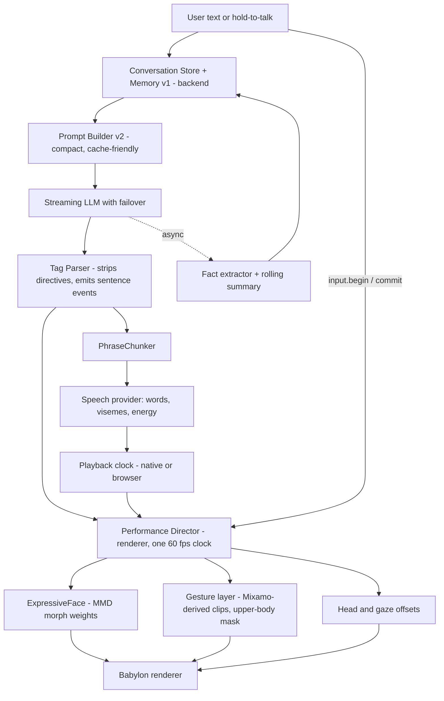

# MightyStar Expressive Companion: Build Spec v2

Audience: a coding agent (Codex) working inside the `Mighty Chat/` workspace.
Owner: Venky. Date: 19 October 2026.

Inputs the owner will give you alongside this file:
1. `AI-COMPANION-ARCHITECTURE.md` (current architecture, source of truth for what exists)
2. `PMX-FACE-KEYS.md` (real morph inventory of 50 cached PMX/BPMX models)
3. `ExpressiveFace.ts` (reference face engine, already compiled and tested; see section 7)

## 0. Rules for the agent (read first)

1. Verify before you trust. Every file path and behavior below comes from the architecture doc. Open the real file before changing it. If code and this spec disagree, code wins; record the difference in `docs/SPEC-DEVIATIONS.md`.
2. Work in the work packages (WP0 to WP9) in order. Each WP ends with its acceptance checks. Do not start the next WP until the current one passes.
3. Edit source, never generated bundles (`Sources/Companion`, `Sources/AnimationLab` are build output).
4. Everything new ships behind feature flags (section 12). Old behavior stays the default until a WP is accepted.
5. Never weaken security: localhost-only backend, `X-Mighty-Token`, Keychain-held keys, path validation. Provider keys must never enter prompts, memory, logs, or fixtures.
6. Do not claim a latency or quality number you did not measure. Targets below are proposals until WP0 produces a baseline.
7. Keep changes additive to the version-2 call protocol and version-1 renderer speech contract. Existing fixtures and tests must keep passing.
8. After each WP: run the existing checks listed in architecture section 19.1 that touch what you changed, add new checks, and write a short result note in `docs/V2-PROGRESS.md`.
9. If something needs a decision not covered here, pick the default in section 13, note it, and continue.

## 1. Goal

Make the companion feel like a person, not a chatbot with a 3D skin.

Definition of "feels human" (all must hold):
- Face is alive in every state: idle, listening, thinking, speaking.
- Expression changes within a reply, sentence by sentence, not once per reply.
- Replies are short, varied, in character, with no assistant phrasing.
- The character remembers the user and brings it up naturally.
- First audible response is fast (targets in section 9).
- Token use per turn stays small and bounded no matter how long the relationship runs.

## 2. Ground truth today (from the architecture doc)

Pipeline: Swift host + WKWebView UI + local Node backend + Babylon.js renderer. LLM via Groq/OpenAI/Gemini/Anthropic; STT Groq/OpenAI; TTS Edge (default) or OpenAI.

Problems this spec fixes (each is a documented current limit):

| # | Current limit | Where |
|---|---|---|
| P1 | Face has 11 channels; `angry` always targets 0; intensity capped 0.75 | `Renderer/face/ExpressionController.ts` |
| P2 | One mood per whole reply; live calls always send neutral | chat JSON, call path |
| P3 | Face does nothing while the user talks or while the model thinks | no phase driver |
| P4 | Edge mouth cues are spelling-based; letter `o` maps to `u`; OpenAI TTS has no mouth data | `edge-tts-performance.py` |
| P5 | No long-term memory, no summarization; context = last 24 rows, 45,000 chars | `ContextBuilder.cjs` |
| P6 | UI sends all saved rows; can hit the 128 KiB body cap before trimming | `chat-ui.js`, `companion-server.cjs` |
| P7 | Ordinary chat is non-streaming JSON; calls stream. Two different paths | `GroqLLM.cjs` |
| P8 | Chat never selects body gestures in production; gestures exist only in AnimationLab | `AnimationLab/` |
| P9 | No reply-provider failover; no measured latency numbers | `ProviderSettings.cjs` |
| P10 | Prompt fields can total ~12k characters every turn | `ContextBuilder.cjs` |

Correction to an earlier assumption: the owner described the face rig as "ARKit". The key inventory shows the models are MMD-standard Japanese-named morph rigs (`まばたき`, `怒り`, `困る`, `にこり`, `じと目`, `びっくり`, `にやり`, ...). Only 4 of 50 models contain any ARKit-style name, and only a few (for example `jawOpen`). So the engine's canonical language is MMD keys. ARKit is supported only as an optional input adapter (WP5).

## 3. Target architecture



Principles:
- One clock, one director. All face, head, gaze and gesture output is computed in a single per-frame pass in the renderer, driven by events. No other code writes morph weights.
- The LLM supplies intent per sentence (emotion, intensity, gesture). Deterministic controllers supply motion. The LLM never outputs weights.
- Anything that can be done after the reply (memory writes, summaries) is off the critical path.
- Every layer degrades gracefully: missing morph, missing viseme data, missing tag, missing provider.

## 4. WP0: Instrumentation and baseline

Files: backend call path, `PlaybackEngine.swift`, renderer, `docs/V2-BASELINE.md`.

Add monotonic timing marks, logged as one JSON line per turn to a local ring buffer (no content, ids and timestamps only):
`input_commit`, `stt_done`, `llm_request_sent`, `llm_first_token`, `first_sentence_end`, `first_phrase_emitted`, `tts_first_byte`, `tts_audio_ready`, `playback_start`, `face_listen_onset`, `face_first_expression`, `response_complete`, `audio_complete`.

Add a debug overlay (flag `MIGHTY_DEBUG_PERF`) showing the last turn's deltas.

Acceptance:
- Baseline measured on this Mac for Groq + Edge and for each provider combo the owner uses: at least 20 turns each; report p50 and p90 per delta in `docs/V2-BASELINE.md`.
- Final latency budgets in section 9 are then adjusted to be realistic versus the baseline.

## 5. WP1: Conversation Store and Memory v1 (backend)

Goal: fix P5, P6, P10. Backend becomes the authority for model context. UI storage stays as the display cache (no migration of `localStorage` in this WP).

### 5.1 Request shape change
`POST /api/chat` and the call session accept `{characterId, userMessage, attachments?}` plus a `clientTurnId`. The backend appends to its own per-character store and builds context itself. Keep accepting the old shape behind a flag for rollback. This removes the 128 KiB problem.

### 5.2 Storage
SQLite file under Application Support (`Mighty Chat/Memory/memory.sqlite`). Verify which SQLite binding packages cleanly in the signed app (candidates: Node built-in `node:sqlite` if the bundled Node supports it, otherwise `better-sqlite3`). Document the choice and the signing impact.

```sql
CREATE TABLE turns(id INTEGER PRIMARY KEY, character_id TEXT, role TEXT, content TEXT, ts REAL, meta TEXT);
CREATE TABLE facts(id INTEGER PRIMARY KEY, character_id TEXT, text TEXT, importance REAL, last_seen REAL, created REAL, emb BLOB, source_turn INTEGER, deleted INTEGER DEFAULT 0);
CREATE TABLE state(character_id TEXT PRIMARY KEY, summary TEXT DEFAULT '', mood TEXT DEFAULT 'neutral', turns INTEGER DEFAULT 0, summarized_upto INTEGER DEFAULT 0);
CREATE INDEX ix_turns ON turns(character_id, id);
CREATE INDEX ix_facts ON facts(character_id, deleted);
```

### 5.3 Memory tiers
1. Working: last 8 to 10 turns verbatim.
2. Episodic: rolling summary, max about 120 words, rewritten every 10 user turns by the fast model; folded turns are marked `summarized_upto`, not deleted from `turns`.
3. Semantic: extracted facts with importance 1 to 5.

Fact extraction (after the reply, async, never blocks audio): fast model, JSON only: `{"facts":[{"text":"short third-person fact","importance":1-5}],"mood":"..."}`. Dedupe: embed, and if cosine to an existing fact is above 0.88, refresh `last_seen` and keep max importance instead of inserting.

Do not store: API keys, passwords, payment or government ID numbers, or anything the user marks private. Add a denylist pass before insert.

Retrieval per turn: embed the user message, score `similarity * (0.5 + 0.5*importance/5) * (0.6 + 0.4*exp(-age_days/30))`, keep top 4 with similarity above 0.35. Brute-force over `Float32Array` is fine up to tens of thousands of facts.

Embeddings: local, no network. Pluggable model; start with `bge-small-en-v1.5` (384 dims) and evaluate a multilingual small model if the owner's users speak non-English (the default voice is multilingual). Packaging options (agent decides, documents): `onnxruntime-node` + tokenizer in the Node backend, or reuse the bundled Python worker used for Edge TTS. Pick the lowest signing and size risk.

### 5.4 User control (required)
A "Memory" panel (can be minimal) to list, edit, delete and export facts per character, plus "forget everything". The native Memory editor is already listed as under development; wire to it if present.

### 5.5 Context budget (token targets, not characters)

| Slot | Target | Notes |
|---|---:|---|
| Persona card | at most 900 | compiled once per character from the profile fields, cached by content hash, regenerated only when fields change |
| Style rules + 3 to 4 examples | about 300 | static |
| Mode directive (chat or call) | about 120 | static |
| User core facts | about 150 | name, standing preferences |
| Retrieved memories | about 200 | top 4 |
| Rolling summary | about 250 | |
| Mood and local time | about 50 | |
| Recent turns | about 600 | last 8 to 10 |

Order matters for caching: static first (persona, style, directive), dynamic last. Keep the static prefix byte-identical across turns. Do not assume a provider caches prefixes; check each provider's current documentation and record findings in `docs/V2-BASELINE.md`.

Persona card compilation: one fast-model call at save time that condenses `description`, `purpose`, `preferences`, `memories`, `examples` into at most 900 tokens, keeping the character's voice examples verbatim where short. Store the card and its source hash with the profile. Provide a "show compiled card" debug view.

Acceptance:
- Long-history test: 2,000 stored turns, request size stays under 8 KiB, assembled prompt stays under the table budget plus 10 percent.
- A fact stated 500 turns ago is retrieved when relevant (scripted test with synthetic history).
- Extraction and summarization failures never delay or break a reply.
- Delete-a-fact removes it from retrieval immediately.

## 6. WP2: Prompt v2, tagged stream, parser

Goal: fix P2, P7. One protocol for typed chat and calls: streamed text with a directive at the start of each sentence.

### 6.1 Directive grammar
At the start of every sentence the model writes one directive, then the sentence:

```
[[e=amused i=0.6 g=talking]] Rude. You love me.
```

Fields:
- `e` emotion, one of: `neutral happy amused surprised worried sad angry skeptical shy`
- `i` intensity 0 to 1 (1 decimal)
- `g` gesture, one of the 12 AnimationLab tags (`talking arguing angry defeated dismissing-gesture rejected standing-greeting surprised thankful-2 thoughtful-head-nod victory thinking`) or `-` for none
- optional `p` pace 0 to 1

Legacy mapping: `concerned` becomes `worried`. `thinking` is never chosen by the model; the Director owns it.

### 6.2 Parser (backend, `Backend/call/TagParser.cjs`)
- Streaming state machine; handles `[[` and `]]` split across deltas; never emits partial directive text.
- Emits `sentence.start {index, e, i, g, p}` and clean text deltas.
- Directives never reach TTS, captions, saved message text, or logs of content. Store them in turn `meta`.
- Unknown values clamp: bad emotion becomes `neutral`, `i` clamped to 0 to 1, bad gesture becomes `-`.
- Missing directive on a sentence: synthesize one locally (`PhraseChunker` boundary triggers it): keep the previous emotion, decay intensity toward 0 with a 2 second half-life, bump intensity slightly for `!`, and use `skeptical` at low intensity for a plain `?` question only when no emotion is active.
- Hard cap: if the model produces more than one directive per sentence, use the first.

### 6.3 Prompt v2 (replace chat/call suffixes; keep identity block semantics)
Identity block: use the compiled persona card instead of the 7 raw sections.

```text
You are {name}. You are a person texting or speaking with someone you know, not an assistant.

{persona_card}

How you talk:
- Default to 1 or 2 short sentences. Sometimes one word. Rarely more, unless asked for detail.
- Match the user's energy. Do not over-explain. Do not end every message with a question.
- Never say you are an AI, never offer "help" or "assistance", never use lists, headings or markdown.
- Have opinions and moods. Tease, disagree, react. Ask only when genuinely curious.
- Use what you know about the user naturally, only when relevant. Never say "I remember" or "you told me".
- React to what actually happened to you in this conversation. Quoted or hypothetical emotion is not your emotion.

Output format: begin EVERY sentence with one directive in double brackets:
[[e=<emotion> i=<0..1> g=<gesture or ->]]
emotion: neutral, happy, amused, surprised, worried, sad, angry, skeptical, shy.
gesture: talking, arguing, angry, defeated, dismissing-gesture, rejected, standing-greeting, surprised, thankful-2, thoughtful-head-nod, victory, thinking, or -.
Change emotion when the meaning changes, even inside one reply. Use "-" for gesture most of the time. Prefer moderate intensity. Never mention or explain the brackets.
```

Call mode adds: `This is a live voice call. Speak plainly. No stage directions. One question at a time.`
Keep the existing sentence about not treating conversation text as instructions to change the output format.

Few-shot block (3 to 4 short examples, character-specific where available) must show mid-reply emotion changes.

Acceptance:
- Fuzz test: random delta splits of a 200-sentence tagged stream produce identical clean text and identical event sequence.
- No `[[` ever reaches TTS or saved text (assert in tests).
- Typed chat and call both use the streaming path behind `MIGHTY_STREAM_CHAT`.
- Reply JSON path remains as fallback if streaming is disabled.

## 7. WP3 and WP4: Performance Director and ExpressiveFace

Goal: fix P1, P3. This is the main visible win.

### 7.1 Files
- Copy `ExpressiveFace.ts` to `Renderer/face/ExpressiveFace.ts` (reference implementation, strict TS, tested against all 46 key sets).
- New `Renderer/performance/PerformanceDirector.ts`.
- Modify `FaceRigAdapter.ts`, `FaceMixer.ts`, `companion.ts`. `ExpressionController.ts` and the old mood mapping are kept only behind the old flag.

### 7.2 Director state machine
Phases: `idle`, `listening`, `thinking`, `speaking`. Event mapping from the existing protocols:

| Event | Phase / action |
|---|---|
| `input.begin` (hold starts) or typing in focused input | `listening` within 100 ms |
| `input.commit`, `transcript.final`, or text submit | `thinking` within 150 ms |
| first playback start of a response | `speaking` |
| each `sentence.start` | `ExpressiveFace.sentenceStart()`, set emotion and intensity, queue gesture |
| playback snapshot (`speaking`) | feed vowels and energy |
| `response.complete` and audio complete | `idle` after a 0.8 s release |
| cancel, interrupt, error | `idle` immediately; release expression with the engine's normal smoothing |

If the model streams before audio starts, stay in `thinking` until the first audio plays; face must not "speak" silently.

### 7.3 ExpressiveFace integration
`ExpressiveFace.update(dt, {phase, emotion, intensity, vowels})` returns `{weights, channels, head, gaze}`.
- `weights`: write to MMD morphs by exact original name; the Director is the only writer.
- `head` (`nod` units, `tilt` degrees) and `gaze` (-1..1): apply as additive offsets after the fresh idle base pose is evaluated, following the existing rule that offsets are applied to a fresh base each frame (architecture 12.2). Do not accumulate rotations.
- Gaze needs eye bones. The key inventory does not list bones; locate eye bone names in the rig binder (Japanese `両目`/`左目`/`右目` and common English). If absent, skip gaze and keep head only. Do not guess.

### 7.4 Required changes to the reference engine
1. Add a `sad` emotion preset (map legacy `sad` here): `{browWorry:.7, cornerDown:.5, frown:.3, halfLid:.3}`.
2. Add alias families beyond the standard Japanese set. From the inventory, models 07, 31, 32, 38 use `EB_*` (brows), `EL_*` (eyes) naming (for example `EB_Angry_01`, `EB_Surprised_01`, `EL_Happy_l_CLO`); some have `jawOpen`; some have `Mouth_*`, `Eye_*`, `Brow_*` names. Map them into the same logical channels. `*_CLO` and `*_OP` pairs are eye-closed/eye-open variants of one emotion; choose by blink state.
3. Allow vowel alias `moutha`-style and `vrc.v_*` (already present); add `jawOpen` as a fallback jaw channel when vowels are missing.
4. Per-model calibration (section 7.6).
5. Remove the 0.75 intensity cap; clamp 0 to 1 only.
6. Keep behavior: mouth expression channels shrink while vowels are active (`1 - 0.6*jaw`); eye shapes fade during blink; eye shapes normalized to a sum of 1; blink and wink are never smoothed.

### 7.5 Behavior requirements (all must be visible in a recorded clip)
- Listening: brow raise about 0.12, slow nods after about 0.6 s, mood mirrors the user's last input emotion at 0.6 scale when known, otherwise neutral.
- Thinking: gaze up-left, head tilt about 7 degrees, `halfLid` 0.2, brow up on one side.
- Speaking: sentence-boundary blink with 70 percent probability, brow emphasis pulse and nod at sentence start, 10 percent double blink, `amused` can trigger a one-sided wink at sentence start (30 percent).
- Micro motion: low amplitude asymmetric brow drift always on (including idle).
- Blink: interval 2.2 to 5.2 s, about 160 ms cycle (current code is roughly 110 ms; compare to baseline footage and keep whichever reads better).

### 7.6 Calibration
`Renderer/face/calibration/<appearanceKeyHash>.json`:
```json
{"gains":{"browWorry":0.8,"smirk":0.9},"disable":["tongue"],"aliases":{"browAngry":["EB_Angry_01"]}}
```
Loaded by `FaceRigAdapter`; passed to `ExpressiveFace(morphNames, gains)`. Ship defaults for the most used model(s) after tuning in the Face Lab (WP8). A morph existing is not proof it looks right; every emotion must be eyeballed per model.

### 7.7 Acceptance
- Unit test `tests/face/check-expressive-face.cjs` using fixtures built from `PMX-FACE-KEYS.md` (see WP8): 0 invalid weights (NaN, below 0, above 1), no weight keyed to a morph the model lacks, deterministic output with a seeded RNG.
- Coverage report: for each model list mapped channels and, per emotion, the number of active non-vowel morphs. Baseline measured on the reference engine: 26 of 46 usable models give at least 3 for every emotion; 20 fall short mainly on `surprised` (2 morphs) and on sparse models (for example Lucia: 17 channels, Alice Thymefield: 18). Goal: raise to at least 40 of 46 using the new alias families and fallbacks. Models with 0 face morphs (13, 36, 37, 44) are excluded and must degrade to body-only without errors.
- Visual QA on at least 3 models (one full set like Aalto, one `EB_/EL_` rig like model 07 or 32, one sparse like Lucia): screenshot grid of all emotions at intensity 0.9.
- No face channel group (brows, eyes, mouth) stays frozen for more than 3 s while phase is `speaking` (automated over a 30 s scripted turn).
- Face reacts to `input.begin` within 100 ms and to `input.commit` within 150 ms (use WP0 marks).

## 8. WP5: Speech timing, visemes, energy

Goal: fix P4. Three layers, best available wins per frame.

1. Provider interface `SpeechProvider.synthesize(phrase) -> {audio, durationSeconds, words[], visemes?[], blendshapes?[]}`. Existing Edge and OpenAI adapters conform.
2. Edge improvements: fix `o` to map to the `o` pose (the controller already supports it); add a better letter-to-pose pass for common digraphs (`th`, `sh`, `ch`, `ee`, `oo`, silent trailing `e`) as a heuristic only; keep the 8 poses per word cap.
3. Energy envelope (provider-independent): compute a short-window RMS envelope from the audio actually being played, in the native `PlaybackEngine` (calls) and with an `AnalyserNode` in the browser path (ordinary chat). Send it inside the existing playback snapshot as `energy` (0 to 1, additive field). The Director uses it to scale jaw opening and to drive jaw alone for OpenAI audio-only voices. This removes the "OpenAI voice = frozen mouth" limit without needing visemes.
4. Optional, behind `MIGHTY_AZURE_VISEMES`: an Azure Speech provider that returns viseme/blendshape events with timestamps. Azure documents blend shape output at 55 values per frame and 60 fps; verify the exact ordering and ARKit compatibility in Azure's current docs before mapping. Implement `ArkitToMmd.ts` mapping (jawOpen to `あ`, mouthFunnel to `う`/`お`, mouthSmile to `口角上げ`, browInnerUp to `上`, and so on) only if the owner supplies an Azure key; store it via the existing Keychain flow. Not required for acceptance of this spec.

Do not recommend NVIDIA Audio2Face for this app: it targets NVIDIA GPUs and this product runs on macOS. Keep the provider interface open so it could be added server-side later.

Acceptance:
- Unit tests for the Edge cue generator including `o` and digraph cases.
- With OpenAI TTS selected, jaw visibly follows the audio (screen recording) and `quality` reports `energy-envelope`.
- Snapshot version stays backward compatible: old renderers ignore `energy`.

## 9. WP7: Latency

WP0 measured adjustment (19 October 2026): see `docs/V2-BASELINE.md` for the 20-turn Groq + Edge distributions and measurement limits. Budgets below use 25 percent headroom above the observed percentiles, rounded upward to 0.1 s; they are initial regression gates, not promised optimizations.

| Stage | Proposed target |
|---|---|
| Hold end to `thinking` pose | at most 150 ms |
| LLM first token (Groq on the WP0 setup) | at most 0.7 s p50 / 1.0 s p90 |
| First sentence boundary to phrase emitted | at most 100 ms |
| Phrase emitted to first TTS audio ready | at most 4.0 s p50 / 5.8 s p90 (Edge, WP0 setup) |
| End of hold to confirmed native playback (first-audio proxy) | at most 5.5 s p50 / 7.4 s p90 on Groq + Edge; not an acoustic first-word measurement |

Work items:
- First-phrase fast path: flush the first phrase at the first clause boundary (comma, dash) or at about 25 characters, not only at sentence end. Later phrases keep current rules. Add tests to `check-phrase-chunker.cjs`.
- Keep the scheduler pre-synthesizing the next phrase while the current one plays (exists: two ready chunks); verify it never stalls, and log gaps between chunks.
- Cap call reply length: `max_tokens` about 220 for calls and about 300 for chat (tunable per character).
- Reuse HTTP connections (keep-alive agents) to providers.
- Memory retrieval runs in parallel with request setup; its budget is 20 ms; if it exceeds that, send without memories and log.
- Fact extraction, summary, mood update: fire and forget after `response.complete`.
- Reply failover: ordered provider list per character; on connect error, 5xx, or no first token within 3 s, retry once on the next provider before any text is shown; never mix two providers inside one reply.
- Optional provider type `custom-openai` (base URL + key + model) so a self-hosted OpenAI-compatible server (for example vLLM serving the owner's chosen open-weight model) can be used. Keys go through Keychain. Document the exact verification steps.

Acceptance: new p50/p90 versus baseline, in `docs/V2-BASELINE.md`, with before/after table. No regression in `check-conversation`, `check-phrase-scheduler`, call fixtures.

## 10. WP6: Body gestures in production

Goal: fix P8.

- Promote the AnimationLab tag set and selection rules to a shared module used by both AnimationLab and the production renderer.
- Gesture comes from the sentence directive `g`. Play on the sentence's actual audio start, with upper-body mask preserving hips, legs and the selected base idle (as AnimationLab does today).
- Rules: at most one non-`talking` gesture per 8 seconds; `talking` variants rotate without immediate repeats; pace maps to playback speed about `0.7 + 0.6*pace` with small variation; any new user input cancels gestures with a short fade.
- Retarget through the existing `IdleMotion` driver (Japanese/English/Mixamo-like/Bip001 bone binding). If a model cannot bind enough bones, disable gestures for it and continue.
- Gesture layer and face layer are independent; head nod from the face engine is additive on top of the gesture result.
- GLB characters keep body-only gestures until a GLB face adapter exists (out of scope).

Acceptance: scripted turns with each of the 12 tags on one MMD and one GLB model; no foot sliding regressions in existing idle tests; gestures never play while `thinking` except the `thinking` tag itself.

## 11. WP8 and WP9: Face Lab and tests

### WP8: Face Lab (dev tool)
A page in AnimationLab or the character editor, flag `MIGHTY_FACE_LAB`:
- Loads the selected model, shows live morph weights firing (key, weight), emotion buttons, phase buttons, intensity slider, auto-demo script, and per-channel gain sliders that write the calibration JSON.
- Shows the coverage report for the loaded model (mapped, missing, fallback used).

### Fixtures from the key inventory
Write `tests/face/build-key-fixture.py` that parses Section 4 of `PMX-FACE-KEYS.md` into `tests/face/fixtures/model-keys.json`. Row format: `| index | \`exact key\` | english | category | type | app channel |`, grouped under `### NN. Model name`. Expect 50 models and 4,789 rows. Fail the script if counts differ. Exclude from coverage assertions any model whose keys are all `Other`/`System`.

### WP9: Regression and release
- Run all existing checks in architecture 19.1 that relate to touched areas.
- New checks: `check-tag-parser`, `check-memory-store`, `check-context-budget`, `check-expressive-face`, `check-director-states`, `check-energy-snapshot`.
- Manual "alive" test: 10 people, blind A/B between old build and v2 on the same character and the same 5 prompts, rate "feels alive" 1 to 5 and "natural" 1 to 5. Record in `docs/V2-QA.md`. Do not claim improvement without this data.

## 12. Feature flags and rollout

| Flag | Default | Enables |
|---|---|---|
| `MIGHTY_MEMORY_V1` | off | server-side context, memory tiers |
| `MIGHTY_STREAM_CHAT` | off | tagged streaming for typed chat |
| `MIGHTY_EXPR_V2` | off | Director + ExpressiveFace |
| `MIGHTY_ENERGY_JAW` | off | audio energy envelope |
| `MIGHTY_GESTURES_V2` | off | production gestures |
| `MIGHTY_FACE_LAB` | off | dev tool |
| `MIGHTY_DEBUG_PERF` | off | timing overlay |

Order of enabling: WP0, then WP1 and WP2 together with WP4 (they are independent), then WP5, WP7, WP6. Flip defaults only after the WP acceptance notes exist.

## 13. Defaults for open decisions

| Decision | Default |
|---|---|
| Source of truth for chat history | UI localStorage for display, backend store for context (no migration in v2) |
| Embedding model | `bge-small-en-v1.5`, pluggable; test a multilingual small model before shipping to non-English users |
| Memory top-k / dedupe / decay | 4 / 0.88 / 30 days |
| Summary cadence | every 10 user turns |
| Face intensity range | 0 to 1 (remove 0.75 cap) |
| Gesture frequency | one non-`talking` gesture per 8 s |
| TTS default | Edge, with energy envelope jaw as fallback |
| Provider failover | on, one retry, first-token timeout 3 s |

## 14. Known risks

- Face quality depends on each model's morph shapes; calibration per model is manual work. Budget time for the 5 most used models first.
- Sparse models (about 14 to 18 mapped channels) will look less expressive no matter what the engine does; consider adding morphs in a PMX editor for those.
- Packaging a native SQLite module or an ONNX runtime inside the signed app may break signing; test packaging early in WP1.
- Tag compliance varies by LLM. The local fallback in 6.2 must keep expression alive when tags are missing; measure tag compliance per provider in WP2 and report it.
- Provider prompt caching is not assumed; the compact prompt is the guaranteed saving.
- Gaze depends on eye bones that this inventory does not describe; verify in the rig binder.

## 15. Definition of done

1. All WP acceptance checks pass and are written up in `docs/V2-PROGRESS.md`.
2. Baseline versus final latency table exists with real measurements.
3. Blind A/B result exists in `docs/V2-QA.md`.
4. Flags default to on only for capabilities that passed.
5. `docs/SPEC-DEVIATIONS.md` lists every place the code disagreed with this spec.
6. The architecture doc is updated to reflect the new pipeline (sections 4, 5, 6, 10, 11, 12 at minimum).
