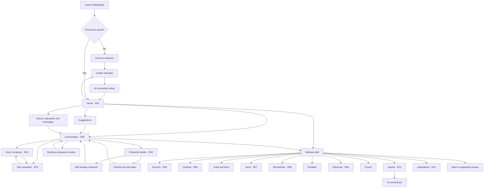
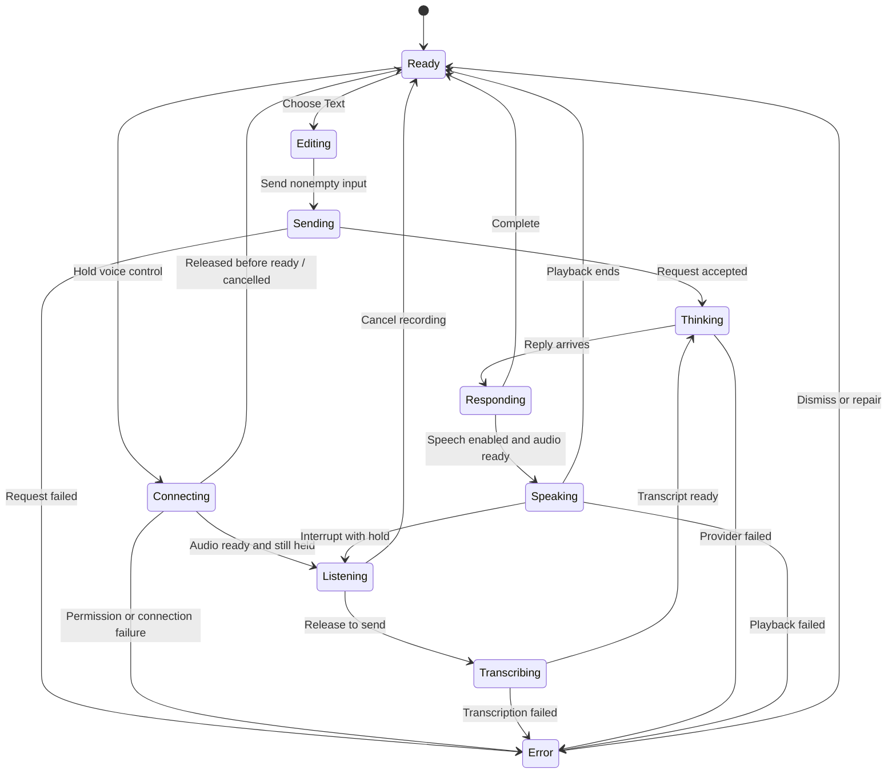
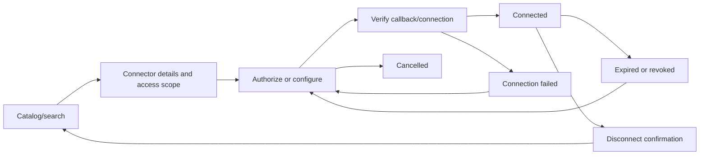

# MightyStar — complete UI workflow

Status: planned behavior, not implemented functionality. Read alongside [the design plan](MIGHTYSTAR-UI-PLAN.md). Observed screens are marked with reference IDs; unobserved transitions are proposed.

## 1. Application map

## 2. Entry, navigation, and character management

| Trigger | Steps | Success / return | Failure / cancellation |
|---|---|---|---|
| First launch | Load saved records → show welcome if empty → create character → configure AI | Home with saved character; text is usable without microphone setup | Skip optional mic setup; show recoverable missing-key guidance on first request |
| Returning launch | Restore characters and preferences → show Home → select character | Correct history, portrait, voice, and draft | Corrupt/missing record produces recovery state; never overwrite remaining data |
| Brand/home action | Save current draft/scroll → select Home | Home greeting and live sidebar | Existing reply may complete into its original conversation |
| Character row | Stop previous voice session → select ID → load history and portrait | Selected glossy row, correct header, correct composer target | Failed asset shows portrait fallback and Retry; chat data remains |
| Search | Type query → match character names and saved messages → choose result | Select character and reveal matching message | Empty state and clear-search; Escape dismisses results |
| Sidebar toggle | Collapse/expand list | More conversation width; selection preserved | Settings uses its own navigation state |
| Plus | Identity → 3D Character → Personality → Review → Save | Persist character; select new chat | Step validation, asset retry; Cancel discards unsaved new record |
| Edit character | Inspector → Edit → same four-step editor prefilled → Save | Existing ID/history retained; all portraits update | Cancel restores previous data; failed save retains editor content |
| Details chip | Open inspector; click close/Escape | Same conversation/draft/scroll | At narrow width inspector overlays; closing restores focus |
| Settings | Store origin → cancel unsent recording → show Account or remembered page | Back restores origin and draft | Failed preference save leaves original value and shows inline retry |
| Apps + | Open Integrations | Return to prior screen through Back | Unavailable catalog has honest empty/error state |

## 3. Conversation lifecycle

This is a user-visible state model. Text response and audio playback can overlap in the existing streaming pipeline; keep transport, request, and playback states separate in implementation. Labels must come from actual events.

### Text workflow

1. Click Type… or invoke the configured text shortcut.
2. Restore the selected character's draft; focus the input.
3. Enter text; optionally attach supported files once attachment support exists.
4. Enter sends; Shift+Enter inserts a line. Empty/invalid input cannot submit.
5. Persist the user message once, show progress, and prevent accidental duplicate submission.
6. Append the reply to the originating character; show copy, timestamp, and supported follow-up actions.
7. If speech is enabled, play through the existing voice/lip-sync pipeline.
8. On failure, retain the user message and offer Retry with the original input. Do not duplicate that message when retrying.

Switching characters during a text request does not retarget the request. If another character's reply finishes, update that character's preview/unread status.

### Voice workflow

1. Mouse/pointer hold or configured native shortcut activates the same voice controller.
2. If permission/key/device is missing, route to the relevant repair screen and preserve context.
3. Show Connecting until audio is ready. Start capture only if still held; avoid accidentally sending a tiny recording after release during connection.
4. Listening shows clear visual feedback. Release commits once; Escape cancels unsent audio.
5. Show transcription/thinking and the resulting user transcript.
6. Render response and speak with synchronized character animation.
7. Interruption stops prior playback before new capture. Stop ends the session.
8. Sleep, character switching, window lifecycle changes, and settings entry must not leave capture running.

### Voice/text switching

Text mode ends active capture/session according to the existing native lifecycle and restores the draft. Voice mode preserves typed draft and never submits it implicitly. Control labels always show the saved shortcut. The miniature mic/character and large voice dock are two presentations of the same controller.

### Attachments — proposed

Paperclip → native file chooser → validate type/size/provider → queued attachment chip → remove or send → processing/result. Cancel returns to draft. Unsupported files produce a clear error before submission. Local file selection alone does not imply that a provider received the file.

## 4. Settings workflows

| Page | Primary workflow | Recovery and persistence |
|---|---|---|
| Account | Load identity/entitlement → view usage → Upgrade or manage account | Local-only state until services exist; failed loading is not zero usage |
| Upgrade | Plan → checkout → verified callback → refresh entitlement | Cancel keeps plan; timeout offers refresh; no success before service confirmation |
| Logout/delete | Explain affected scope → confirm → execute → show result | Failure keeps account state; deletion must distinguish cloud account and local data |
| General | Change preference → native apply → saved feedback | Revert UI on failure; unavailable OS capability explains why |
| Updates | Check → checking → up-to-date/update/error | Never claim current on connection failure; install behavior requires a real updater |
| Voice | Choose engine/scope → select card → preview → save selection | Stop previous preview; missing key opens AI connections; current speech remains coherent |
| Speed | Select chip → validate/save → next spoken reply uses value | Reject unsupported values; 0.5× needs backend changes |
| Microphone | Discover devices → choose device → save → test → stop | Unplugged/denied device produces guidance and explicit fallback; meter is real input |
| Shortcuts | Change → capture combination → validate → Save | Conflict/unsupported error, Cancel, focus restoration; preserve existing values during migration |
| Reset shortcuts | Reset → confirm → restore valid defaults | No other preferences reset |
| Dictation | Invoke → capture → transcribe → insert at focused location | Stop/cancel; if insertion unavailable retain copyable transcript; never send it as chat by accident |
| Hands-free dictation | Invoke configured repeated chord → listen → invoke again → transcribe/insert | Persistent recording indicator and Escape cancellation |
| Cursor | Change status/companion setting → native apply → preview | Controls do not intercept pointer events; supported-display fallback |
| Agents folder | Select folder → validate access → save path | Cancel unchanged; access revoked shows repair action |
| AI connections | Select provider/model → enter new key → native secure save → verify status | Clear input after handoff; never expose stored key; key presence alone is not live verification |
| Autonomy/announcements | Change specific setting → persist → supported runtime applies | Unsupported capability remains unavailable; scope described per control |
| Invite & Earn | Load real referral link → copy/share → show real status | Unavailable service state; sharing is an explicit user action |

For voice settings, per-character values remain per-character. When no character exists, edit defaults for future characters and label that scope. General, microphone, shortcut, and integration settings are app-wide.

## 5. Integrations workflow — proposed backend work

- Connected and available sections derive from actual saved connection state.
- Custom connector: name/endpoint → authentication → validation → test → save → catalog entry.
- Disconnect invalidates/removes credentials as supported, updates dependent routines, and confirms completion.
- A connected service does not by itself authorize every proposed external action. Runtime action confirmation follows the app's explicitly configured scope.
- Empty catalog, no search matches, offline, unsupported provider, and authorization refusal each have separate messages.

## 6. Suggestions and routine workflows — proposed backend work

Suggestion: open Suggestions → inspect proposed task → select character → start → see work in that conversation. Dismiss removes it from the inbox and updates the count. A suggestion is not an already-running job.

Routine: open character details or request repetition in chat → draft task and schedule → display human-readable cadence, time zone, next run, required apps, and any usage implications → explicit Save → routine appears in inspector.

Routine lifecycle: scheduled → queued → running → completed, failed, or needs attention. Completion adds a result to the correct character history. Pause disables future launches; Resume recomputes next run; Edit shows new schedule before saving; Delete removes future runs without deleting previous results. Define behavior for sleep/offline and missed runs before enabling scheduling; default to showing a missed-run state rather than silently executing a backlog. Changing time zone must update the displayed next run consistently.

A routine requiring an expired connector shows Needs connection and offers repair. A cancelled task is distinct from a failed task. Notifications follow actual completion/failure and the saved announcement preferences.

## 7. Desktop and window behavior

Keep existing Overlay → Portrait → Screensaver → Holographic routes and return to chat. The top-right overlapping-window control uses the companion/view action; its exact Clicky behavior is not established by static screenshots. Treat this mapping as proposed. The in-content X returns to Home; native red traffic light retains the app's documented close behavior until explicitly changed.

Keep menu-bar access to open chat, character settings, voice status, and view modes. Exactly one active audio session owns recording/playback. Desktop and main-window character expressions observe the same session identity and playback clock.

Shortcut popover: information button → anchored menu → Edit → Shortcuts. Escape closes only the topmost transient surface first, not every panel and the character view at once.

## 8. Required review scenarios

| Scenario | Expected result |
|---|---|
| No saved character | Home offers creation; Settings still opens |
| Switch character with a draft | Each character restores its own text |
| Switch during pending reply | Response saves to its original character |
| Hold then release before connection | No stuck capture or unintended submission |
| Microphone permission refused | Explain repair; text remains usable |
| Open Settings while recording | Unsent recording cancels; no background capture |
| Model download fails | Retry/fallback; existing history and appearance survive |
| Choose unavailable speech engine | Explain missing setup; no misleading voice preview |
| Select 0.5× | Enabled only after genuine end-to-end support |
| Microphone unplugged during test | Test ends/falls back explicitly; selection state stays truthful |
| Shortcut conflicts with another binding | Reject/save nothing until resolved |
| Settings save fails | Visible error and previous persisted value |
| No integration matches | Search empty state, no fabricated entries |
| Authorization cancelled | Connector stays disconnected |
| Routine blocked by expired connection | Needs connection; no false completion |
| Narrow window with inspector | Panel overlays; composer stays reachable |
| Long response while user reads earlier text | Preserve scroll; offer new-message jump |
| Relaunch after UI migration | Same characters, histories, keys, voices, shortcuts and companion modes |

Review order: Home → character selection → voice → text → inspector → edit/create → shortcut popover → each settings page → error paths → desktop modes → relaunch and persistence. Check visual fidelity and actual behavior separately; both must pass before calling the redesign complete.
